# 30 System Design Concepts Every Software Engineer Must Know

This handbook explains 30 foundational system design concepts using practical scenarios, architecture diagrams, advantages, trade-offs, and implementation examples. The examples repeatedly use realistic systems such as e-commerce, banking, food delivery, streaming, and large-scale SaaS applications so the concepts connect together rather than feel isolated.

---

## 1. Load Balancer

### What it is
A **Load Balancer** distributes incoming network requests across multiple application servers so that no single server becomes overloaded.

### Why it is needed
Without a load balancer, every request may hit one server. Once that server reaches CPU, memory, or connection limits, the entire application can slow down or fail even if other servers are available.

### Diagram

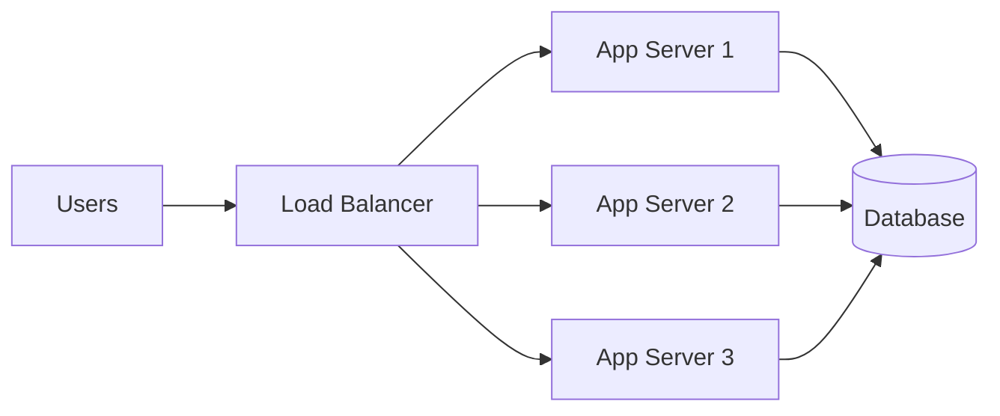

### Real-time scenario
Imagine an e-commerce website during a festival sale. Ten thousand users open the application at the same time.

Instead of sending all traffic to one Spring Boot instance:

- Request 1 goes to Server A.
- Request 2 goes to Server B.
- Request 3 goes to Server C.
- If Server B becomes unhealthy, the load balancer stops sending traffic to it.

### Common load-balancing strategies

- **Round Robin** — requests are distributed sequentially.
- **Least Connections** — requests go to the server with the fewest active connections.
- **Weighted Round Robin** — powerful servers receive more requests.
- **IP Hash** — requests from the same client can be routed to the same backend.

### Advantages

- Improves availability.
- Supports horizontal scaling.
- Prevents one server from becoming a bottleneck.
- Enables health checks and automatic failover.
- Allows rolling deployments with minimal downtime.

### Trade-offs

- Adds another infrastructure component.
- Misconfiguration can become a single point of failure.
- Sticky sessions can complicate scaling.

### Examples

- NGINX
- HAProxy
- AWS Application Load Balancer
- Azure Load Balancer
- Google Cloud Load Balancing
- Kubernetes Service / Ingress

---

## 2. API Gateway

### What it is
An **API Gateway** is a single entry point that receives client requests and routes them to appropriate backend services.

### Diagram

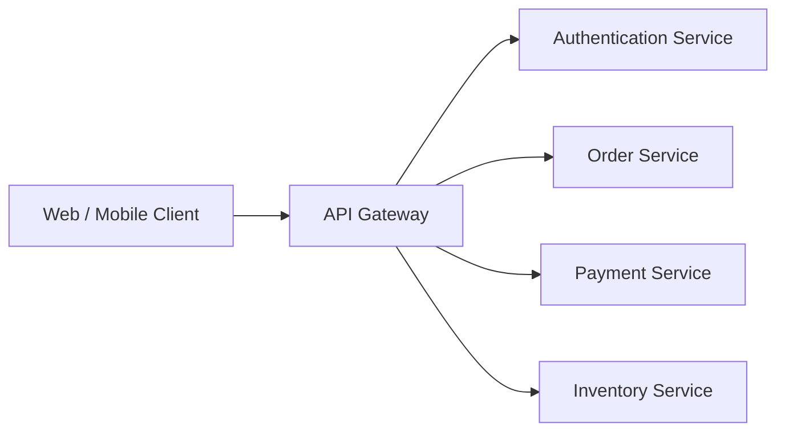

### Real-time scenario
A food delivery mobile application needs data from:

- User Service
- Restaurant Service
- Order Service
- Payment Service
- Delivery Service

Instead of exposing every microservice directly to the mobile application, the mobile application calls:

```text
https://api.company.com
```

The gateway then routes:

```text
/api/users/*      -> User Service
/api/orders/*     -> Order Service
/api/payments/*   -> Payment Service
```

### Responsibilities

An API Gateway may handle:

- Authentication and authorization
- Request routing
- Rate limiting
- SSL termination
- Request/response transformation
- Logging
- API versioning
- Circuit breaking

### Advantages

- Hides internal microservice topology.
- Centralizes security.
- Simplifies clients.
- Provides consistent monitoring and rate limiting.
- Allows backend services to evolve independently.

### Trade-offs

- Can become a bottleneck if poorly designed.
- Adds latency.
- Too much business logic in the gateway creates tight coupling.

### Examples

- Spring Cloud Gateway
- Kong
- Apigee
- AWS API Gateway
- IBM API Connect
- NGINX

---

## 3. CDN

### What it is
A **Content Delivery Network (CDN)** caches static or cacheable content at geographically distributed edge locations close to users.

### Diagram

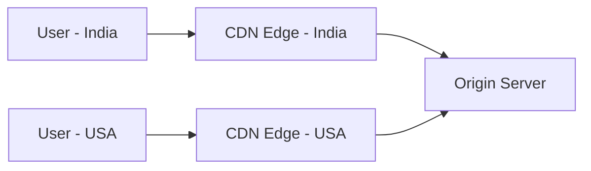

### Real-time scenario
Suppose Netflix stores a movie file in one origin data center in the United States. A user in India should not download every video segment directly from the US.

Instead:

1. The CDN stores frequently requested movie segments at an Indian edge node.
2. Users in India retrieve those segments from the nearby edge.
3. Only uncached content travels to the origin server.

### Good CDN candidates

- Images
- JavaScript
- CSS
- Videos
- PDFs
- Software downloads
- Public API responses with safe caching rules

### Advantages

- Lower latency.
- Reduced load on origin servers.
- Faster global delivery.
- Better resistance to traffic spikes.
- Often includes DDoS protection.

### Trade-offs

- Cache invalidation must be managed.
- Dynamic or personalized data cannot always be cached.
- Additional cost and operational configuration.

### Examples

- Cloudflare
- Amazon CloudFront
- Akamai
- Fastly
- Google Cloud CDN

---

## 4. Caching

### What it is
**Caching** stores frequently accessed data in a faster storage layer so future requests avoid expensive database or service calls.

### Diagram

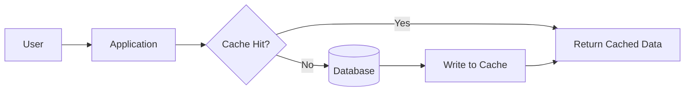

### Real-time scenario
A product page receives 100,000 views per hour, but product information changes only a few times per day.

Instead of querying MySQL 100,000 times:

1. Application looks in Redis.
2. If product exists, return immediately.
3. If not, query MySQL.
4. Store the result in Redis for future requests.

### Common strategies

#### Cache-aside
Application checks cache first and loads data from the database on a miss.

#### Write-through
Application writes data to cache and database together.

#### Write-behind
Writes reach cache first, while the database is updated asynchronously.

### Advantages

- Reduces database load.
- Improves latency.
- Increases throughput.
- Can protect downstream services.

### Trade-offs

- Cache invalidation is difficult.
- Stale data may be returned.
- Cache stampede can occur after expiry.

### Examples

- Redis
- Memcached
- Caffeine
- Hazelcast

---

## 5. Database Indexing

### What it is
A **database index** is an auxiliary data structure that lets the database locate records without scanning every row.

### Diagram

```text
Without index:
Table -> Row 1 -> Row 2 -> Row 3 -> ... -> Row 10,000,000

With index:
Index(email)
   |
   +--> user@example.com -> Row 8,124,551
```

### Real-time scenario
A users table contains 50 million records.

Query:

```sql
SELECT * FROM users WHERE email = 'user@example.com';
```

Without an index, the database may scan millions of rows.

With:

```sql
CREATE INDEX idx_users_email ON users(email);
```

the database can locate the row much faster.

### Advantages

- Faster reads.
- Faster filtering, joins, sorting, and lookups when designed correctly.
- Supports uniqueness constraints.

### Trade-offs

- Additional disk space.
- Inserts and updates become more expensive because indexes must also be maintained.
- Too many indexes can degrade write performance.

### Example

For a mortgage table:

```sql
CREATE INDEX idx_loan_customer_status
ON mortgage_loan(customer_id, loan_status);
```

This helps queries such as:

```sql
SELECT *
FROM mortgage_loan
WHERE customer_id = 10001
AND loan_status = 'ACTIVE';
```

---

## 6. Database Replication

### What it is
**Replication** maintains copies of the same database data on multiple database servers.

### Diagram

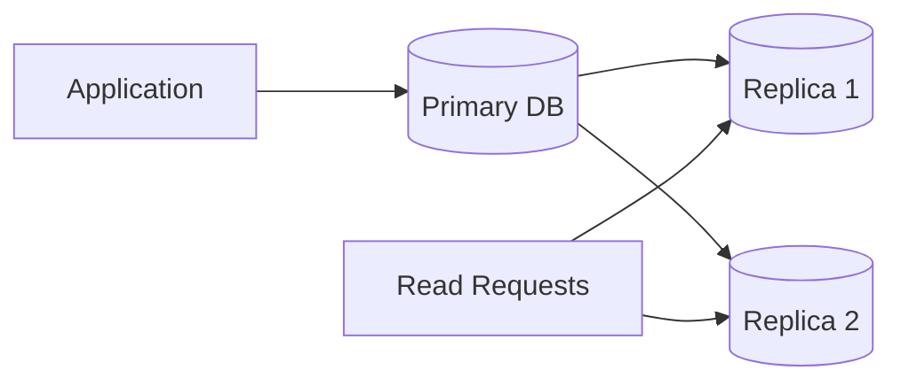

### Real-time scenario
A banking application performs:

- 20,000 read queries per second.
- 1,000 writes per second.

All writes go to the primary database. Read-only operations such as transaction-history views can be routed to replicas.

### Types

- Primary-replica
- Multi-primary
- Synchronous replication
- Asynchronous replication

### Advantages

- Improves read scalability.
- Adds redundancy.
- Supports disaster recovery.
- Can improve availability.

### Trade-offs

- Replication lag may cause stale reads.
- Failover requires careful coordination.
- Multi-primary setups can create write conflicts.

---

## 7. Database Sharding

### What it is
**Sharding** splits data horizontally across multiple independent databases.

### Diagram

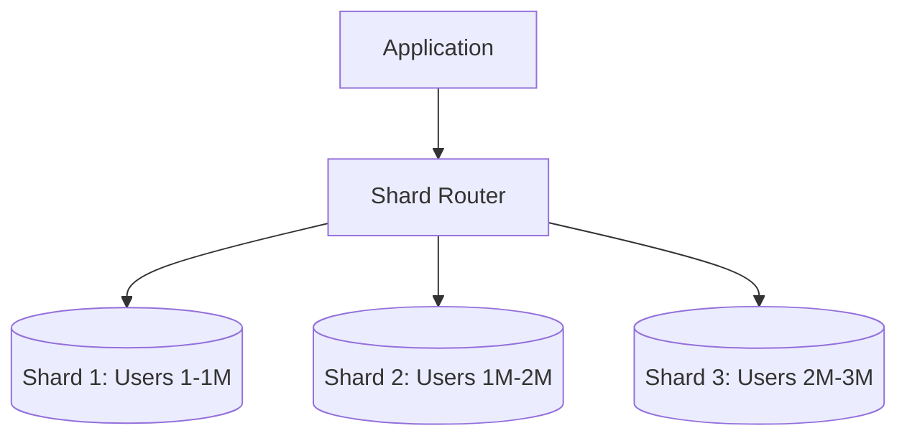

### Real-time scenario
A social media platform has two billion users. One database is no longer sufficient.

The platform could shard by `user_id`:

```text
user_id % 4 = shard number
```

Example:

```text
1001 -> Shard 1
1002 -> Shard 2
1003 -> Shard 3
1004 -> Shard 0
```

### Advantages

- Handles datasets larger than one machine.
- Improves write throughput.
- Enables horizontal database scaling.

### Trade-offs

- Cross-shard joins are difficult.
- Resharding is complex.
- Hot shards may occur with poor shard keys.
- Transactions across shards are difficult.

---

## 8. Partitioning

### What it is
**Partitioning** divides a large logical table into smaller physical pieces while the database often continues presenting it as one table.

### Diagram

```text
TRANSACTIONS table

+-------------------------+
| Partition: 2026-01      |
+-------------------------+
| Partition: 2026-02      |
+-------------------------+
| Partition: 2026-03      |
+-------------------------+
```

### Real-time scenario
A transaction table stores billions of records. Most queries request only the latest month.

Partitioning by month lets the database inspect only the relevant partition instead of scanning the entire table.

### Common partitioning types

- Range partitioning
- Hash partitioning
- List partitioning
- Time-based partitioning

### Advantages

- Faster access to subsets of data.
- Easier archival and deletion.
- Better maintenance of very large tables.

### Trade-offs

- Poor partition keys may provide little benefit.
- Global indexes and cross-partition queries can be complicated.

### Sharding vs partitioning

**Partitioning** is usually managed inside one database system.

**Sharding** distributes data across separate database servers or clusters.

---

## 9. Horizontal Scaling

### What it is
**Horizontal scaling** means adding more machines or instances rather than increasing the power of one machine.

### Diagram

```text
Before:
[Server A]

After:
[Server A] [Server B] [Server C] [Server D]
```

### Real-time scenario
A Spring Boot application handles 1,000 requests/second per instance.

Demand grows to 4,000 requests/second.

Instead of replacing the server with a giant machine, deploy four instances behind a load balancer.

### Advantages

- Better fault tolerance.
- Supports very large scale.
- Capacity can be increased gradually.
- Works well with cloud auto-scaling.

### Trade-offs

- Requires stateless services or distributed session management.
- Introduces network coordination.
- Distributed systems become more complex.

---

## 10. Vertical Scaling

### What it is
**Vertical scaling** increases CPU, RAM, storage, or network capacity on one machine.

### Diagram

```text
Before:
4 CPU / 16 GB RAM

After:
32 CPU / 128 GB RAM
```

### Real-time scenario
A MySQL server starts experiencing heavy queries. The quickest short-term solution may be upgrading from 16 GB RAM to 64 GB RAM.

### Advantages

- Easy to implement.
- Little application redesign.
- Useful for databases and legacy systems.

### Trade-offs

- Hardware limits eventually appear.
- Large machines become expensive.
- Still represents one failure domain.
- Upgrades may require downtime.

---

## 11. Message Queues

### What it is
A **Message Queue** lets one service send work to another service asynchronously.

### Diagram

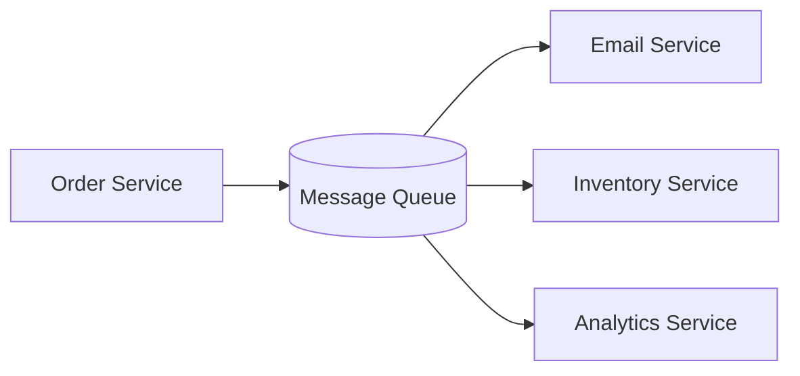

### Real-time scenario
When a customer places an order, the API should not wait for:

- Email generation
- Invoice generation
- Inventory analytics
- Marketing events

The Order Service sends messages to a queue and immediately returns success to the customer.

### Advantages

- Decouples services.
- Absorbs traffic spikes.
- Supports asynchronous processing.
- Enables retries and durable processing.

### Trade-offs

- Adds eventual consistency.
- Requires message monitoring.
- Duplicate delivery must be handled.

### Examples

- RabbitMQ
- Apache Kafka
- Amazon SQS
- ActiveMQ
- Azure Service Bus

---

## 12. Event-Driven Architecture

### What it is
In **Event-Driven Architecture (EDA)**, components communicate by producing and reacting to events that describe something that has happened.

### Diagram

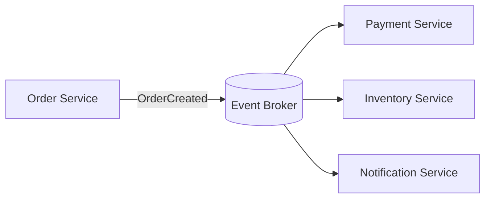

### Real-time scenario
When an order is created:

```text
OrderCreated
```

is published.

Different services independently react:

- Payment Service starts payment.
- Inventory Service reserves stock.
- Notification Service sends confirmation.
- Analytics Service records a conversion.

### Advantages

- Loose coupling.
- High extensibility.
- Good for asynchronous workflows.
- Services can evolve independently.

### Trade-offs

- Harder debugging.
- Ordering and duplication require care.
- Event schemas need governance.

---

## 13. Publish/Subscribe

### What it is
In **Publish/Subscribe**, a publisher sends a message to a topic and multiple subscribers receive independent copies.

### Diagram

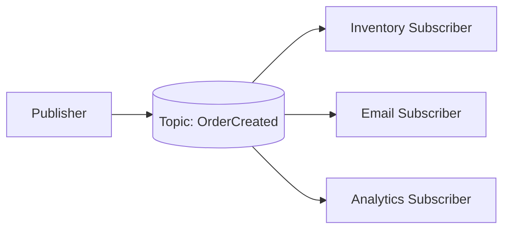

### Real-time scenario
When a stock price changes, a market-data service publishes:

```text
PriceUpdated: SBIN = 1,050.20
```

Subscribers may include:

- Trading UI
- Risk engine
- Alert engine
- Historical-data service

### Queue vs Pub/Sub

A queue often distributes a unit of work to one consumer from a consumer group.

Pub/Sub distributes an event to multiple interested subscribers.

### Advantages

- Easy fan-out.
- Producers do not need to know consumers.
- New consumers can be added without changing the producer.

### Examples

- Kafka topics
- Google Pub/Sub
- AWS SNS
- RabbitMQ exchanges

---

## 14. CQRS

### What it is
**CQRS — Command Query Responsibility Segregation** separates write operations from read operations.

### Diagram

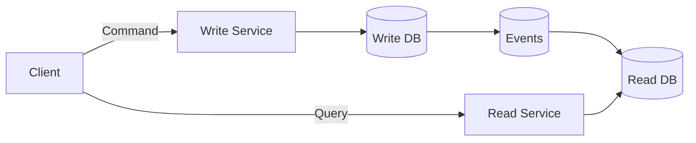

### Real-time scenario
An e-commerce catalog receives relatively few product updates but millions of product reads.

The write model can use a normalized relational database.

The read model can use Elasticsearch or a denormalized document model optimized for fast searches.

### Advantages

- Read and write workloads scale independently.
- Each side can use different storage technologies.
- Complex read models can be optimized heavily.

### Trade-offs

- More moving parts.
- Read model may lag behind the write model.
- Not necessary for ordinary CRUD applications.

---

## 15. Event Sourcing

### What it is
**Event Sourcing** stores every state-changing event rather than storing only the latest state.

### Diagram

```text
Account Events

1. AccountOpened       +₹0
2. MoneyDeposited      +₹10,000
3. MoneyWithdrawn      -₹2,000
4. MoneyDeposited      +₹5,000

Current Balance = Replay(events) = ₹13,000
```

### Real-time scenario
A banking ledger benefits from knowing exactly how an account reached its current state.

Instead of only storing:

```text
balance = ₹13,000
```

store the sequence of immutable transactions.

### Advantages

- Complete audit history.
- State can be reconstructed.
- Useful for debugging and compliance.
- Enables temporal queries.

### Trade-offs

- Event schema evolution is difficult.
- Replaying millions of events can be expensive.
- Usually requires snapshots.

---

## 16. Saga Pattern

### What it is
A **Saga** manages a business transaction that spans multiple microservices by using a sequence of local transactions and compensating actions.

### Diagram

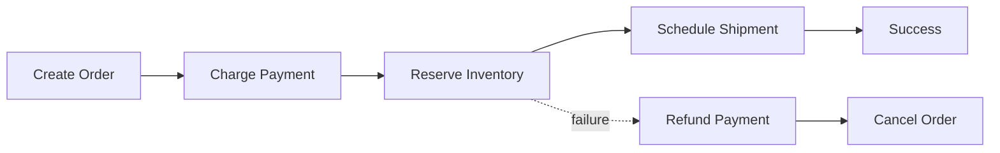

### Real-time scenario
Consider purchasing a laptop:

1. Create order.
2. Charge customer.
3. Reserve laptop.
4. Schedule delivery.

If inventory reservation fails after payment succeeds, the system must compensate by refunding the customer.

### Saga styles

- **Choreography** — services react to events.
- **Orchestration** — a central saga orchestrator tells each service what to do.

### Advantages

- Avoids long distributed database locks.
- Works well across microservices.
- Supports eventual consistency.

### Trade-offs

- Compensation logic can be difficult.
- Debugging long workflows is complex.
- Business teams must define reversible actions.

---

## 17. Circuit Breaker

### What it is
A **Circuit Breaker** stops calling a failing downstream service for a period of time.

### Diagram

```text
CLOSED
  |
Failures exceed threshold
  v
OPEN ---- wait ----> HALF_OPEN
 ^                    |
 |<---- failure ------|
        success
           |
           v
         CLOSED
```

### Real-time scenario
Order Service calls Payment Service.

Payment Service becomes unavailable.

Without a circuit breaker, thousands of threads continue waiting for timeouts.

With a circuit breaker:

- After repeated failures, the circuit opens.
- New calls fail immediately or use fallback logic.
- Later, limited test requests check whether the service recovered.

### Advantages

- Prevents cascading failures.
- Reduces wasted resources.
- Provides faster failure responses.

### Examples

- Resilience4j
- Envoy
- Istio

---

## 18. Retry Pattern

### What it is
The **Retry Pattern** repeats a failed operation when the failure may be temporary.

### Diagram

```text
Request
  |
  v
Attempt 1 -> Failed
  |
Wait 100 ms
  v
Attempt 2 -> Failed
  |
Wait 200 ms
  v
Attempt 3 -> Success
```

### Real-time scenario
A service calls a third-party payment API and gets an HTTP `503 Service Unavailable` because one node is restarting.

A retry after a short delay may succeed.

### Recommended strategy

Use exponential backoff:

```text
100 ms
200 ms
400 ms
800 ms
```

Optionally add random jitter so thousands of clients do not retry simultaneously.

### Advantages

- Handles transient failures.
- Improves resilience.

### Trade-offs

- Retrying permanent failures creates extra load.
- Retrying non-idempotent operations can duplicate work.
- Must have a maximum retry count.

---

## 19. Rate Limiting

### What it is
**Rate Limiting** controls how many requests a user, client, API key, or IP address can make during a period.

### Diagram

```text
Client -> Rate Limiter -> API
          |
          +--> 95 requests: allow
          +--> 101st request: HTTP 429
```

### Real-time scenario
A banking OTP endpoint should not permit unlimited OTP requests.

Policy:

```text
Maximum 5 OTP requests per user per 10 minutes
```

### Algorithms

- Fixed window
- Sliding window
- Token bucket
- Leaky bucket

### Advantages

- Prevents abuse.
- Protects infrastructure.
- Helps guarantee fair usage.
- Reduces accidental traffic storms.

### Examples

- API Gateway rate limits
- Redis token bucket
- NGINX rate limiting
- Bucket4j

---

## 20. Idempotency

### What it is
An operation is **idempotent** if repeating the same request produces the same intended effect as performing it once.

### Diagram

```text
POST /payments
Idempotency-Key: ABC123

1st request -> Payment created
2nd request -> Return original result
3rd request -> Return original result
```

### Real-time scenario
A customer presses **Pay** and the network times out. The mobile application retries.

Without idempotency:

```text
₹5,000 charged twice
```

With an idempotency key, the payment service detects that the operation already succeeded and returns the previous result.

### Advantages

- Prevents duplicate payments/orders.
- Makes retries safer.
- Essential in distributed systems with at-least-once delivery.

### Examples

- Payment APIs
- Order creation APIs
- Message consumers storing processed event IDs

---

## 21. CAP Theorem

### What it is
The **CAP Theorem** states that during a network partition, a distributed data system must choose between:

- **Consistency (C)** — every read sees the latest successful write.
- **Availability (A)** — every request receives a non-error response.
- **Partition tolerance (P)** — the system continues operating despite network communication failures between nodes.

### Diagram

```text
          Consistency
             /\
            /  \
           /    \
          /      \
Partition -------- Availability
Tolerance
```

### Real-time scenario
Two database nodes are separated by a network failure.

If Node A accepts a write that Node B cannot receive:

- A CP system may reject some requests until nodes can agree.
- An AP system may continue accepting operations and reconcile later.

### Important clarification
Real distributed systems generally must tolerate network partitions, so the practical decision during a partition is usually between consistency and availability.

### Examples

- ZooKeeper / etcd lean toward CP behavior.
- Cassandra and Dynamo-style systems are commonly designed toward AP behavior with tunable consistency.

---

## 22. Eventual Consistency

### What it is
**Eventual Consistency** means replicas or services may temporarily disagree, but they converge to the same state if no new updates occur.

### Diagram

```text
Write -> Primary = 100
             |
             +--> Replica A = 100
             +--> Replica B = 95   <- temporary lag

After replication:
Replica B = 100
```

### Real-time scenario
A social-media user gains a follower.

The profile page may immediately display:

```text
10,001 followers
```

while another region temporarily displays:

```text
10,000 followers
```

A short time later both converge.

### Advantages

- High availability.
- Good global scalability.
- Works well for non-critical stale reads.

### Trade-offs

- Users may temporarily observe stale data.
- Conflict-resolution strategy may be required.

### Poor candidates

Some operations require stronger consistency, such as preventing double spending or enforcing critical inventory constraints.

---

## 23. Service Discovery

### What it is
**Service Discovery** allows services to dynamically find network locations of other service instances.

### Diagram

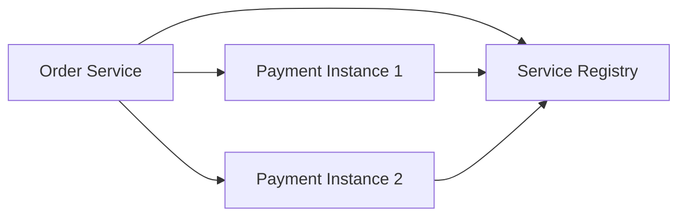

### Real-time scenario
Payment Service runs as five Kubernetes pods. Their IP addresses change as pods restart.

Order Service should not hard-code:

```text
10.0.2.41
```

Instead it asks a service registry or uses Kubernetes DNS:

```text
payment-service.default.svc.cluster.local
```

### Advantages

- Supports dynamic scaling.
- Removes hard-coded addresses.
- Helps route around failed instances.

### Examples

- Kubernetes Service/DNS
- Eureka
- Consul
- etcd

---

## 24. Distributed Transactions

### What it is
A **Distributed Transaction** coordinates one logical operation across multiple independent resources or services.

### Diagram

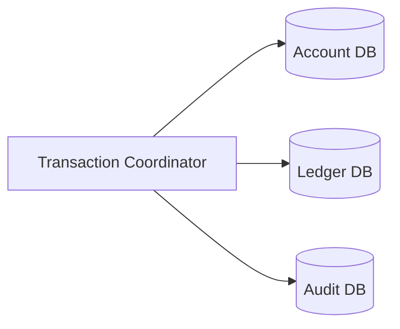

### Real-time scenario
A bank transfer may require:

1. Debit Account A.
2. Credit Account B.
3. Record ledger transaction.

If any step fails, the system needs a strategy to maintain correctness.

### Approaches

- Two-Phase Commit (2PC)
- Saga Pattern
- Transactional Outbox
- Event-driven compensation

### Two-Phase Commit concept

```text
Phase 1: PREPARE
Coordinator asks all participants if they can commit.

Phase 2: COMMIT
If everyone agrees, commit everywhere.
Otherwise roll back.
```

### Advantages

- Can provide strong transactional guarantees.

### Trade-offs

- Coordination is expensive.
- Locks may remain open.
- Failures can block progress.
- Often unsuitable for large independent microservices.

---

## 25. WebSockets

### What it is
**WebSockets** provide a persistent full-duplex connection between client and server.

### Diagram

```text
Browser <====================> Server
        persistent connection

Client -> Server messages
Server -> Client messages
```

### Real-time scenario
A stock trading application must continuously push prices to browsers.

Polling every second would produce large amounts of repeated HTTP traffic.

With WebSockets, the server can push:

```text
SBIN: ₹1048.20
SBIN: ₹1048.75
SBIN: ₹1049.10
```

immediately as updates arrive.

### Good use cases

- Chat
- Trading dashboards
- Multiplayer games
- Collaborative editing
- Live notifications

### Advantages

- Low-latency two-way communication.
- Avoids repeated HTTP polling.

### Trade-offs

- Persistent connection management.
- Harder scaling and connection routing.
- Requires reconnect logic.

---

## 26. gRPC

### What it is
**gRPC** is a high-performance Remote Procedure Call framework commonly used for service-to-service communication.

It typically uses:

- HTTP/2
- Protocol Buffers
- Strongly typed contracts

### Diagram

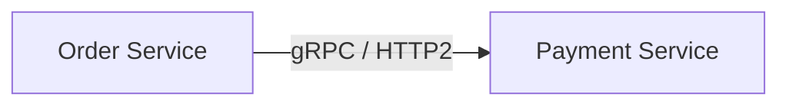

### Example contract

```protobuf
service PaymentService {
  rpc Charge(ChargeRequest) returns (ChargeResponse);
}
```

### Real-time scenario
A high-volume microservice platform performs millions of internal calls every minute.

Compared with verbose JSON REST APIs, Protocol Buffers reduce message size and serialization overhead.

### Advantages

- High performance.
- Compact payloads.
- Strong typing.
- Supports streaming.
- Automatic client/server code generation.

### Trade-offs

- Less human-readable than JSON.
- Browser support is less straightforward than ordinary REST.
- Requires schema governance.

### Good fit

Use REST for public APIs when interoperability and readability matter.

Use gRPC for internal low-latency service communication when strong contracts and performance matter.

---

## 27. Distributed Tracing

### What it is
**Distributed Tracing** follows one request across multiple services using a shared trace identifier.

### Diagram

```text
Trace ID: T-98172

API Gateway       20 ms
  |
Order Service     40 ms
  |
Payment Service  800 ms   <- bottleneck
  |
Database          30 ms
```

### Real-time scenario
A customer reports:

```text
Checkout takes 3 seconds.
```

The request travels through:

```text
Gateway -> Order -> Inventory -> Payment -> Notification
```

Distributed tracing reveals exactly which service consumed the time.

### Core terms

- Trace
- Span
- Trace ID
- Span ID

### Advantages

- Finds latency bottlenecks.
- Helps debug cross-service failures.
- Visualizes service dependencies.

### Examples

- OpenTelemetry
- Jaeger
- Zipkin
- Datadog APM
- Dynatrace

---

## 28. Observability

### What it is
**Observability** is the ability to understand the internal state of a system by examining the signals it produces.

### Three primary pillars

```text
Logs     -> What happened?
Metrics  -> How much / how often?
Traces   -> Where did the request go?
```

### Diagram

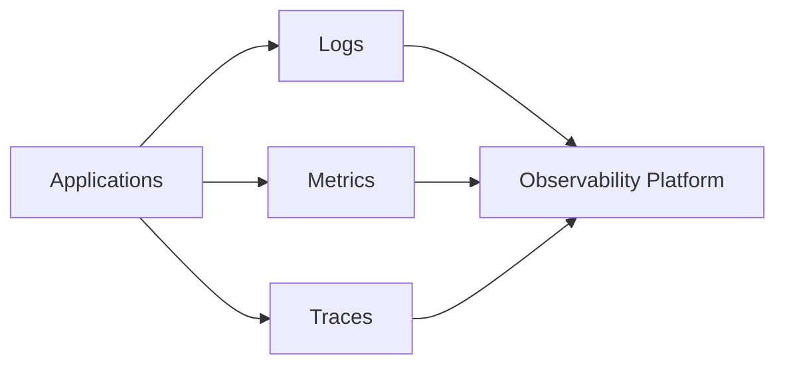

### Real-time scenario
Checkout failures rise from 0.2% to 8%.

Metrics reveal:

```text
payment_error_rate = 8%
```

Logs reveal:

```text
Connection timeout calling payment provider
```

Traces show the slowdown begins inside Payment Service.

### Additional signals

- Profiles
- Events
- Business KPIs
- SLOs / SLIs

### Advantages

- Faster incident response.
- Supports proactive alerting.
- Helps capacity planning.
- Improves root-cause analysis.

### Examples

- Prometheus + Grafana
- OpenTelemetry
- ELK / Elastic Stack
- Splunk
- Datadog
- Dynatrace

---

## 29. Backpressure

### What it is
**Backpressure** prevents a fast producer from overwhelming a slower consumer.

### Diagram

```text
Producer: 10,000 msgs/sec
        |
        v
   [Buffer / Queue]
        |
        v
Consumer: 2,000 msgs/sec

Without control -> queue grows indefinitely
With backpressure -> producer slows, drops, batches, or waits
```

### Real-time scenario
A telemetry platform receives one million device events per second, but the analytics service can process only 700,000.

Without backpressure:

- Queues grow.
- Memory increases.
- Latency increases.
- System eventually crashes.

With backpressure, the system may:

- Slow producers.
- Limit concurrency.
- Batch events.
- Reject excess requests.
- Drop low-priority messages.

### Advantages

- Protects consumers.
- Stabilizes overloaded systems.
- Prevents memory exhaustion.

### Examples

- Reactive Streams
- Project Reactor
- Kafka consumer flow control
- TCP flow control

---

## 30. Dead Letter Queue

### What it is
A **Dead Letter Queue (DLQ)** stores messages that could not be processed successfully after normal retries.

### Diagram

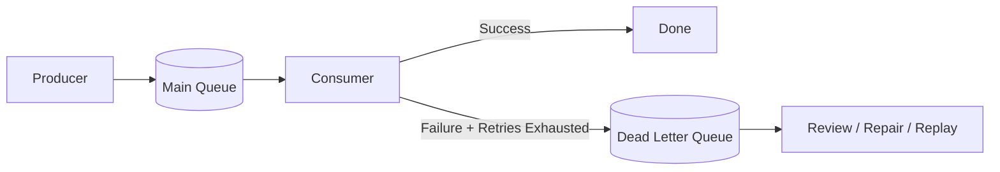

### Real-time scenario
An order event contains an invalid customer ID.

The consumer retries three times:

```text
Attempt 1 -> failed
Attempt 2 -> failed
Attempt 3 -> failed
```

Rather than retry forever and block the queue, the message is moved to a DLQ.

An operations team or automated repair service can inspect and replay it later.

### Advantages

- Prevents poison messages from blocking processing.
- Preserves failed messages for investigation.
- Enables controlled replay.

### Trade-offs

- DLQs require monitoring.
- Messages should not remain forgotten indefinitely.
- Replay must consider idempotency.

### Examples

- RabbitMQ dead-letter exchanges
- AWS SQS DLQ
- Kafka retry/DLQ topics
- Azure Service Bus dead-letter queues

---

# How These 30 Concepts Work Together

A real production architecture rarely uses just one concept. Most large systems combine many of them.

Consider an e-commerce platform:

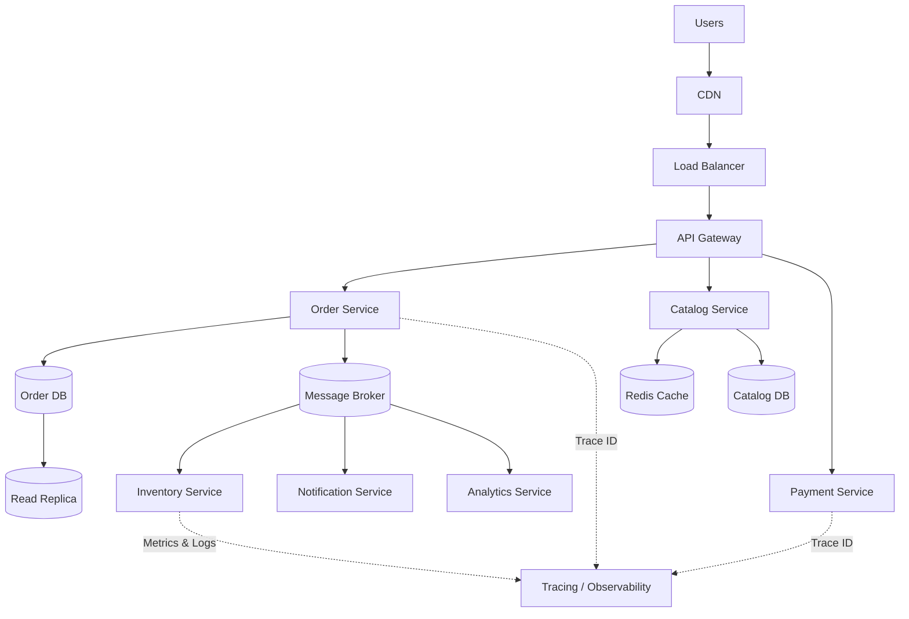

### Request flow

1. **CDN** serves cached images and static assets.
2. **Load Balancer** distributes incoming traffic.
3. **API Gateway** authenticates and routes requests.
4. **Rate Limiting** protects public APIs.
5. **Service Discovery** finds active microservice instances.
6. **Caching** avoids repeated catalog database reads.
7. **Database Indexing** accelerates queries.
8. **Replication** scales database reads.
9. **Partitioning / Sharding** handles massive datasets.
10. **Horizontal Scaling** adds more service instances as load grows.
11. **Message Queues** asynchronously process background work.
12. **Event-Driven Architecture** distributes business events.
13. **Pub/Sub** allows multiple services to react independently.
14. **Saga** coordinates order, payment, inventory, and delivery.
15. **Idempotency** prevents duplicate payments or orders.
16. **Retry** handles temporary network failures.
17. **Circuit Breaker** isolates unhealthy downstream services.
18. **DLQ** captures permanently failing messages.
19. **Backpressure** protects slow consumers.
20. **Observability and Distributed Tracing** reveal failures and latency.

---

# A Practical Mental Model for System Design Interviews

When you receive a design problem such as:

> Design Amazon, Netflix, Uber, Zomato, WhatsApp, or a banking platform.

Think through the problem in this order.

## Step 1: Estimate scale

Ask:

```text
How many users?
How many requests per second?
How much data?
Read-heavy or write-heavy?
What latency is acceptable?
```

## Step 2: Define APIs

Example:

```http
POST /orders
GET /orders/{id}
POST /payments
GET /products/{id}
```

## Step 3: Design the data model

Choose appropriately between:

- SQL
- NoSQL
- Search engine
- Object storage
- Cache

## Step 4: Handle traffic

Think about:

```text
CDN
    ↓
Load Balancer
    ↓
API Gateway
    ↓
Services
```

## Step 5: Scale compute

Use:

- Horizontal scaling
- Auto-scaling
- Stateless services
- Service discovery

## Step 6: Scale storage

Consider:

- Indexing
- Replication
- Partitioning
- Sharding
- Caching

## Step 7: Decouple workloads

Use:

- Queues
- Events
- Pub/Sub

## Step 8: Protect the system

Use:

- Rate limiting
- Timeouts
- Retries
- Circuit breakers
- Idempotency
- Backpressure
- DLQs

## Step 9: Maintain correctness

Think about:

- Transactions
- Sagas
- Consistency
- CAP theorem
- Eventual consistency

## Step 10: Make it observable

Every production system should expose:

```text
Logs
Metrics
Traces
Alerts
Dashboards
```

---

# Quick Comparison Table

| Concept | Main Problem Solved | Typical Example |
|---|---|---|
| Load Balancer | Distribute traffic | NGINX / AWS ALB |
| API Gateway | Central API entry point | Spring Cloud Gateway / Kong |
| CDN | Global content latency | CloudFront / Cloudflare |
| Caching | Repeated expensive reads | Redis |
| Database Indexing | Slow queries | B-tree index |
| Database Replication | Read scale / redundancy | MySQL replicas |
| Database Sharding | Database scale-out | User-based shards |
| Partitioning | Large table management | Monthly partitions |
| Horizontal Scaling | More compute capacity | More pods |
| Vertical Scaling | Stronger single machine | More CPU/RAM |
| Message Queues | Async work | RabbitMQ / SQS |
| Event-Driven Architecture | Loose coupling | Domain events |
| Publish/Subscribe | Fan-out | Kafka topics |
| CQRS | Separate read/write optimization | Read model + write model |
| Event Sourcing | Complete history | Ledger events |
| Saga Pattern | Cross-service business transaction | Order/payment workflow |
| Circuit Breaker | Cascading failure protection | Resilience4j |
| Retry Pattern | Transient failure handling | Exponential backoff |
| Rate Limiting | Abuse / overload protection | Token bucket |
| Idempotency | Duplicate operation prevention | Payment key |
| CAP Theorem | Distributed-system trade-offs | CP vs AP |
| Eventual Consistency | Availability at scale | Replication lag |
| Service Discovery | Dynamic service locations | Kubernetes DNS |
| Distributed Transactions | Multi-resource correctness | 2PC / Saga |
| WebSockets | Real-time duplex communication | Chat / stocks |
| gRPC | High-performance RPC | Internal microservices |
| Distributed Tracing | Cross-service debugging | OpenTelemetry |
| Observability | Understand production behavior | Metrics/logs/traces |
| Backpressure | Protect slow consumers | Reactive Streams |
| Dead Letter Queue | Isolate failed messages | SQS DLQ / RabbitMQ DLX |

---

# Final Takeaway

The most important lesson is that system design is not about memorizing individual technologies. It is about recognizing the **problem each pattern solves**.

For example:

```text
Too much traffic?          -> Load Balancer + Horizontal Scaling
Database too slow?         -> Indexing + Cache + Replicas
Database too large?        -> Partitioning + Sharding
Services tightly coupled?  -> Queue + Events + Pub/Sub
Downstream service failing?-> Timeout + Retry + Circuit Breaker
Duplicate operations?      -> Idempotency
Cross-service transaction? -> Saga
Global stale reads okay?   -> Eventual Consistency
Production issue unknown?  -> Logs + Metrics + Traces
Consumer overwhelmed?      -> Backpressure
Message keeps failing?     -> Dead Letter Queue
```

A strong software engineer should be able to explain not only **what a pattern is**, but also:

1. What problem caused the need for it.
2. Where it fits in the architecture.
3. What new complexity it introduces.
4. What failure scenarios must be handled.
5. When it should **not** be used.

That mindset is what turns a collection of technologies into real system-design skill.
